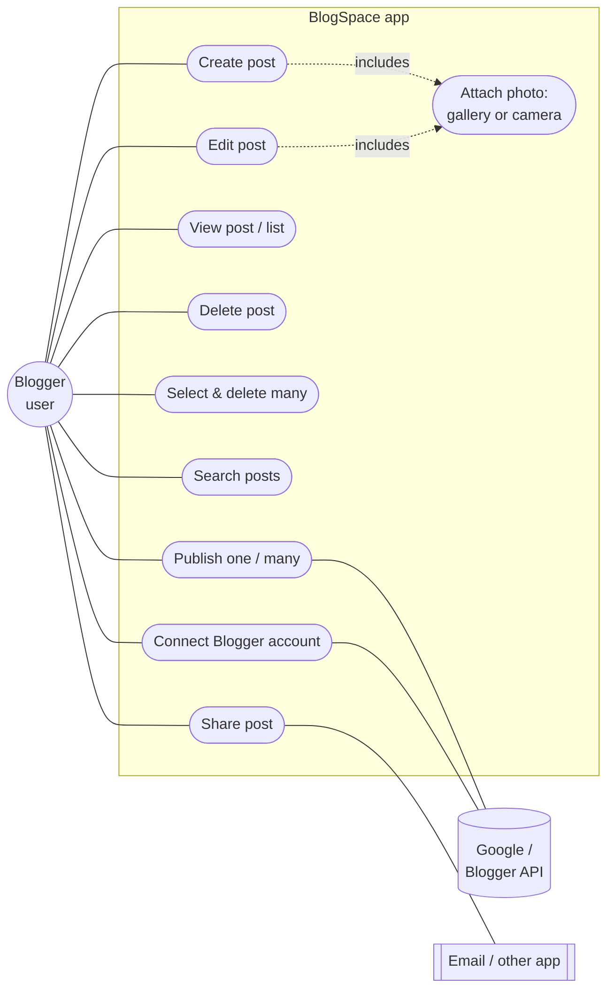
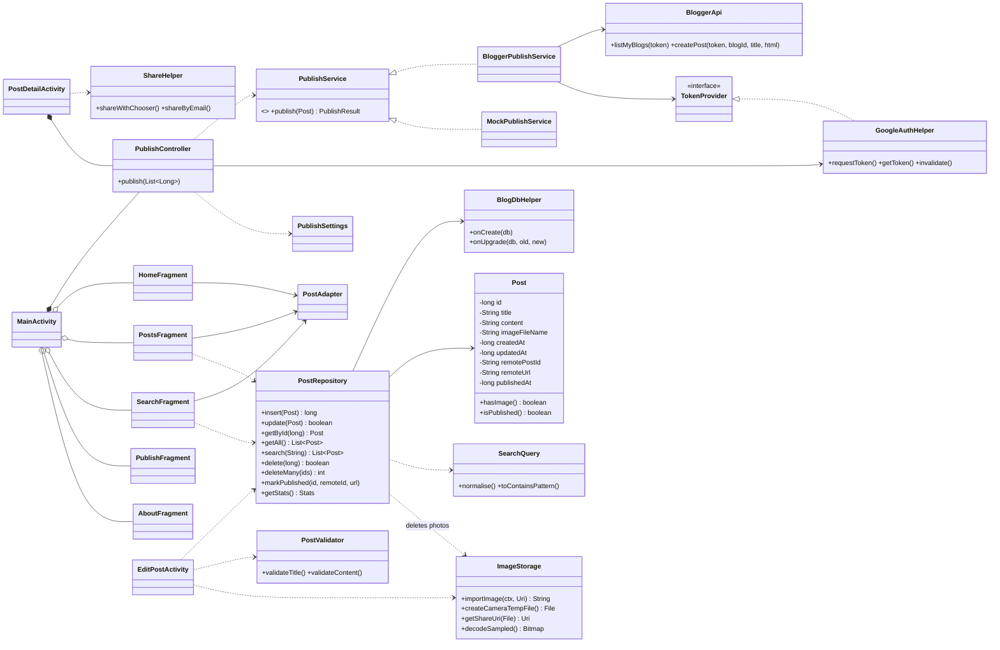
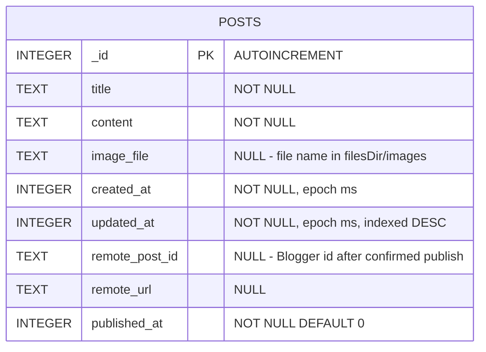
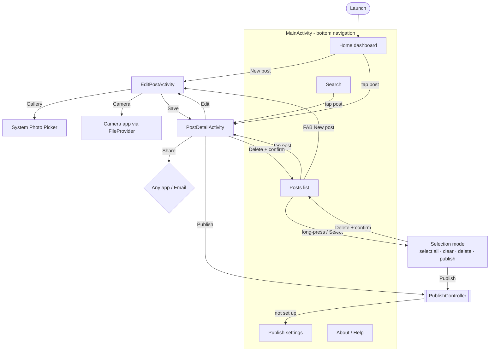
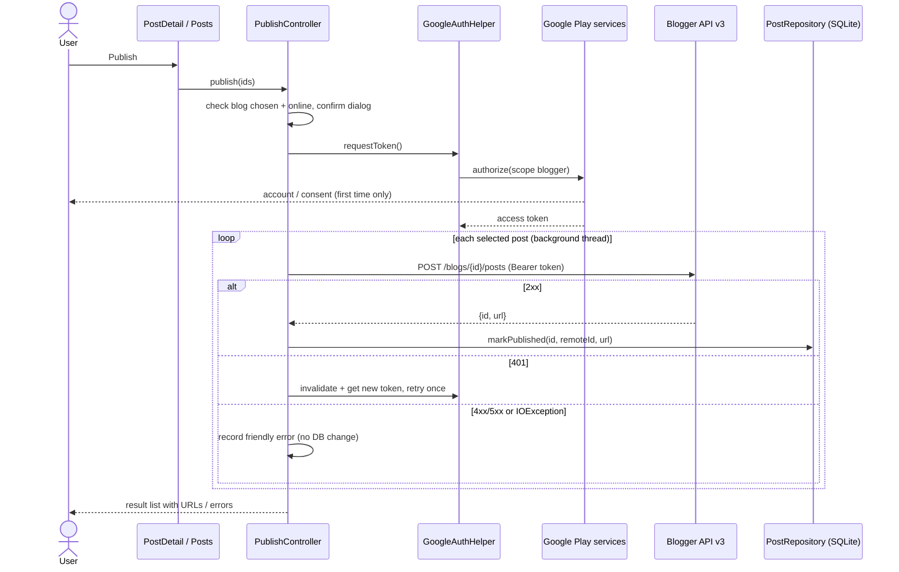

# BlogSpace — Software Design

Diagrams are written in Mermaid. Rendered PNGs are in `docs/diagrams/`.

## 1. Use cases

## 2. Class diagram

## 3. Database design (SQLite)

* One table, because a post has exactly one optional photo. Photos are stored as files, not BLOBs.
  This keeps the database small and lets FileProvider share the file directly.
* `remote_*` and `published_at` record only **confirmed** Blogger publishes.
* Search: `title LIKE ? ESCAPE '\' OR content LIKE ? ESCAPE '\'` with a bound `%term%` pattern.
* Bulk delete runs inside one transaction, and photo files are removed only after the commit.

## 4. Screen flow

## 5. Publish sequence

## 6. Key design decisions
| Decision | Reason |
|---|---|
| Copy every photo into `filesDir/images` as a scaled, EXIF-rotated JPEG | Gallery URIs and temporary camera files can stop working after a restart. A JPEG works for every share target, and HEIC/PNG/WebP all become one format |
| Photo Picker and camera intent, with **no** storage or CAMERA permissions | Least privilege, and no runtime permission prompts |
| FileProvider plus `FLAG_GRANT_READ_URI_PERMISSION` and ClipData | Gives the receiving app temporary read access to one file only |
| Repository is the only class with SQL; all arguments are bound | Prevents SQL injection, and keeps the UI code free of database logic |
| Background executors for SQLite, images and network | The UI thread never blocks |
| Blogger via Google AuthorizationClient (OAuth 2.0) | Official API. No secrets in the app, and Google handles the password |
| Test mode is a separate `PublishService` and never writes "published" | Development rehearsal cannot be mistaken for real publishing |
